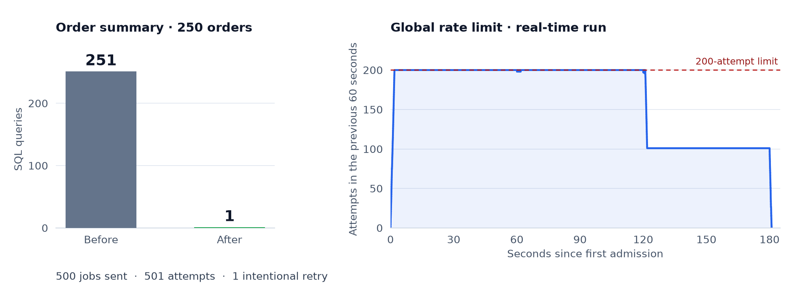
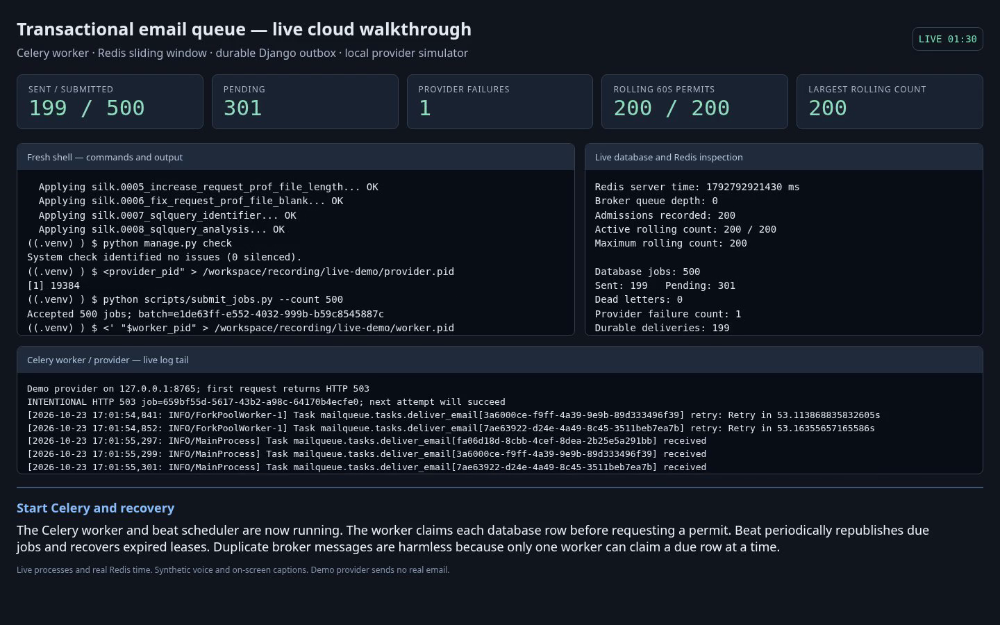

# Django performance & job queue

[](https://github.com/AbhiramJayasankar/full-stack-developer-assessment/actions/workflows/tests.yml)

An N+1 query investigation and a durable email queue with a global **200-attempt rolling-minute limit**. Built with Python 3.12, Django 5.2, Celery 5.5 and Redis 7.4.

## Measured results



| Assessment section | Result | Evidence / reasoning |
| --- | --- | --- |
| 1 · Diagnose the regression | **251 → 1 SQL queries** for 250 orders | [Silk capture](evidence/silk-queries.json) · [Investigation](ANSWERS.md#section-1--incident-investigation-and-fix) |
| 2 · Async email queue | **500 sent**, 501 attempts, one retry; rolling peak **200** | [Timestamp trace](evidence/queue-500-jobs.json) · [Design](DESIGN.md) |
| 3 · Architecture review | Admin performance and pagination trade-offs | [Written answers](ANSWERS.md#section-3--written-architecture-review) |

**12 tests pass**, including a real Celery worker and Redis broker. The default suite uses a one-second test window; the chart above uses the separately verified **60-second production window**. [Test results](evidence/tests.xml)

## Run locally

Requires Python 3.12+ and Docker Compose, or an existing Redis server. Dependencies are pinned. Orders are synthetic; the default provider sends no email.

```sh
python -m venv .venv
source .venv/bin/activate
pip install -r requirements.txt
docker compose up -d --wait redis
python manage.py migrate
pytest -q
python scripts/profile_orders.py
python manage.py runserver
```

Open the [fixed summary](http://127.0.0.1:8000/api/orders/summary/) and [Silk profiler](http://127.0.0.1:8000/silk/). Profiling creates 250 orders and captures SQL for both the broken and fixed views.

## Run the queue

In separate activated terminals:

```sh
# Terminal 1
celery -A config worker --loglevel=INFO --concurrency=1

# Terminal 2 — required for outbox and expired-lease recovery
celery -A config beat --loglevel=INFO

# Terminal 3
python scripts/submit_jobs.py --count 500
python scripts/queue_status.py
docker compose exec redis redis-cli ZCARD email:provider:sliding-window
```

The limiter counts failed attempts too. SQLite supports the local demo; use PostgreSQL for production concurrency. Provider idempotency is required to prevent duplicate emails after an ambiguous response or worker crash. [Failure and recovery details](DESIGN.md)

## Watch the walkthrough · 5:30

[](https://github.com/AbhiramJayasankar/full-stack-developer-assessment/raw/refs/heads/main/evidence/queue-walkthrough.mp4)

**[Watch / download MP4](https://github.com/AbhiramJayasankar/full-stack-developer-assessment/raw/refs/heads/main/evidence/queue-walkthrough.mp4)** · [Subtitles](evidence/queue-walkthrough.srt) · [Recording report](evidence/queue-recording-report.json)

Live capture of 500 jobs, full-minute throttling and a deliberate HTTP 503 followed by retry. Narration uses an offline Kokoro neural voice. The run uses an isolated database and Redis database 14; no real email is sent.

<details>
<summary>Configuration and additional checks</summary>

- Windows activation: `.venv\Scripts\activate`. Skip Compose if Redis is already running.
- `REDIS_URL` overrides application Redis; `TEST_REDIS_URL` overrides test Redis (default database 15). Tests use unique keys without flushing shared data.
- `EMAIL_PROVIDER_URL` accepts JSON `to`, `subject`, `body` and an `Idempotency-Key` header. For a deliberate one-time failure, run `python scripts/demo_provider.py` and set the worker's provider URL to `http://127.0.0.1:8765`.
- Demo endpoints are unauthenticated. Before production, add account-scoped authentication, remove the broken view, restrict Silk, and set a stable `DJANGO_SECRET_KEY`.

Repeat the full-minute test (about two minutes):

```sh
TEST_RATE_WINDOW_MS=60000 QUEUE_EVIDENCE_PATH=evidence/queue-500-jobs.json pytest tests/test_burst.py -q
```

CI also runs Django system checks and migration drift detection. To redraw the chart, install `matplotlib` and run `python scripts/plot_evidence.py`.

</details>
